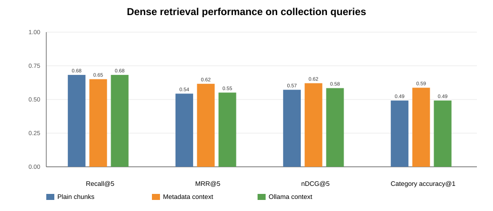
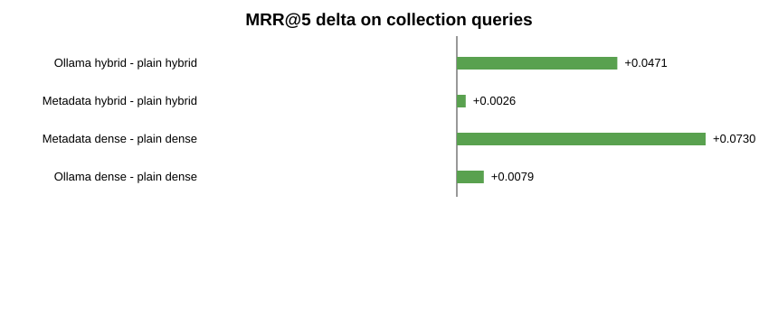

# Contextual Retrieval Evaluation Results for Paper Inclusion

This section reports the retrieval evaluation for the local Ollama-based XAI-RAG knowledge base. It is written as a paper-ready results subsection and can be adapted directly into the experimental evaluation section.

## Experimental Setting

- **Run identifier:** `20260630_013954`
- **Corpus:** 44 downloaded research PDFs represented as 338 page-aware chunks.
- **Embedding model:** `nomic-embed-text` via local Ollama.
- **Context-generation model:** `qwen2.5:latest` via local Ollama.
- **Chunking:** first 8 pages per document, up to 8 chunks per document, 260 words per chunk, 60 words overlap.
- **Evaluation depth:** `K = 5`.
- **Retrieval variants:** dense vector retrieval and hybrid retrieval. Hybrid retrieval combines normalized dense similarity with BM25 lexical matching.
- **Compared chunk representations:** plain chunk text, metadata-contextualized chunk text, and Ollama-generated contextualized chunk text.

## Corpus Composition

| Category | Chunks |
| --- | --- |
| A_student_mental_health | 40 |
| B_college_depression_anxiety | 42 |
| C_loneliness_isolation | 24 |
| D_academic_impairment | 32 |
| E_financial_food | 24 |
| F_sleep_wellbeing | 40 |
| G_screening_communication | 32 |
| H_xai_calibration | 56 |
| I_rag_llm_eval | 48 |

The chunk distribution is intentionally multi-domain. It includes student mental-health screening, depression/anxiety scales, loneliness, academic impairment, financial hardship, protective factors, screening communication, XAI/calibration, and RAG/LLM evaluation literature.

## Metrics

- **Recall@5:** equals 1 when at least one relevant document appears among the top five retrieved chunks.
- **MRR@5:** reciprocal rank of the first relevant document within the top five.
- **nDCG@5:** ranking-sensitive score that rewards relevant documents appearing earlier.
- **Category accuracy@1:** whether the top-ranked chunk belongs to the expected expertise category.

Two query sets were used. The `collection_query` set contains the original corpus-construction search queries and therefore measures internal coverage of the curated knowledge base. The `manual_challenge` set contains seven manually written use-case queries representing expected RAG questions for the paper.

## Aggregate Results

| Condition | Mode | Query set | N | Recall@5 | MRR@5 | nDCG@5 | Cat. Acc@1 |
| --- | --- | --- | --- | --- | --- | --- | --- |
| Metadata context | Dense | collection query | 63 | 0.6508 | 0.6164 | 0.6208 | 0.5873 |
| Ollama context | Dense | collection query | 63 | 0.6825 | 0.5513 | 0.5844 | 0.4921 |
| Plain chunks | Dense | collection query | 63 | 0.6825 | 0.5434 | 0.5722 | 0.4921 |
| Metadata context | Hybrid | collection query | 63 | 0.7460 | 0.6783 | 0.6895 | 0.6508 |
| Ollama context | Hybrid | collection query | 63 | 0.8254 | 0.7228 | 0.7481 | 0.6508 |
| Plain chunks | Hybrid | collection query | 63 | 0.7937 | 0.6757 | 0.6998 | 0.6190 |
| Metadata context | Dense | manual challenge | 7 | 1.0000 | 0.9286 | 0.9634 | 0.8571 |
| Ollama context | Dense | manual challenge | 7 | 1.0000 | 1.0000 | 0.9790 | 1.0000 |
| Plain chunks | Dense | manual challenge | 7 | 1.0000 | 1.0000 | 0.9690 | 1.0000 |
| Metadata context | Hybrid | manual challenge | 7 | 1.0000 | 1.0000 | 0.9976 | 1.0000 |
| Ollama context | Hybrid | manual challenge | 7 | 1.0000 | 1.0000 | 1.0000 | 1.0000 |
| Plain chunks | Hybrid | manual challenge | 7 | 1.0000 | 1.0000 | 0.9861 | 1.0000 |

## Main Finding

The strongest configuration on the larger `collection_query` set was **Ollama-generated contextual chunks with hybrid retrieval**, reaching **Recall@5 = 0.8254**, **MRR@5 = 0.7228**, **nDCG@5 = 0.7481**, and **category accuracy@1 = 0.6508**.

Compared with plain hybrid retrieval, Ollama-context hybrid retrieval improved the collection-query score by:

| Comparison | Metric | Delta |
| --- | --- | --- |
| Ollama hybrid vs plain hybrid | Recall@5 | +0.0317 |
| Ollama hybrid vs plain hybrid | MRR@5 | +0.0471 |
| Ollama hybrid vs plain hybrid | nDCG@5 | +0.0483 |
| Ollama dense vs plain dense | Recall@5 | +0.0000 |
| Ollama dense vs plain dense | MRR@5 | +0.0079 |
| Metadata dense vs plain dense | MRR@5 | +0.0730 |
| Metadata hybrid vs plain hybrid | MRR@5 | +0.0026 |

The result is nuanced. Contextualization alone did not consistently improve dense retrieval: dense Ollama context had the same Recall@5 as plain dense retrieval on collection queries, but a slightly higher MRR@5 and nDCG@5. The clearest gain appears when contextualization is combined with BM25 lexical retrieval, especially for acronym-heavy and terminology-heavy queries such as PHQ-9, GAD-7, SHAP, calibration, and RAG faithfulness.

## Charts

### Hybrid retrieval on collection queries

This chart shows that the Ollama-context hybrid configuration gives the best collection-query Recall@5, MRR@5, and nDCG@5. Category accuracy@1 is tied with metadata-context hybrid and above plain hybrid.

### Dense retrieval on collection queries

Dense-only retrieval is less conclusive. Metadata context improves MRR@5 over plain dense retrieval, but it reduces Recall@5. Ollama context matches plain dense Recall@5 and gives a small MRR@5 improvement. Therefore, the paper should avoid claiming that contextual embeddings alone are sufficient.

### Manual challenge queries

All hybrid variants reached perfect Recall@5 and MRR@5 on the seven manually written challenge queries. Ollama-context hybrid reached perfect nDCG@5 as well. Because this set is small, it should be presented as a targeted sanity check rather than the main quantitative benchmark.

### MRR@5 deltas

The MRR@5 delta chart makes the central interpretation visible: contextualization is most useful when paired with hybrid retrieval, while dense-only contextualization gives only small ranking gains.

## Miss Analysis

| Condition | Mode | Query set | Misses | Miss rate |
| --- | --- | --- | --- | --- |
| Metadata context | Dense | collection query | 22 | 34.92% |
| Metadata context | Hybrid | collection query | 16 | 25.40% |
| Ollama context | Dense | collection query | 20 | 31.75% |
| Ollama context | Hybrid | collection query | 11 | 17.46% |
| Plain chunks | Dense | collection query | 20 | 31.75% |
| Plain chunks | Hybrid | collection query | 13 | 20.63% |

The miss analysis confirms the aggregate trend. Hybrid retrieval reduces misses compared with dense-only retrieval. The lowest miss rate on collection queries is obtained by Ollama-context hybrid retrieval.

## Paper-ready Interpretation

The evaluation supports the following claim:

> In the local Ollama-based knowledge base, generated contextual chunk descriptions improved retrieval most clearly when used as part of a hybrid dense-plus-BM25 retriever. On the collection-query benchmark, Ollama-context hybrid retrieval achieved the best Recall@5, MRR@5, and nDCG@5 among all evaluated variants.

A cautious version suitable for a scientific paper is:

> Contextual chunking did not uniformly improve dense retrieval by itself. However, when the same contextualized chunks were used in a hybrid retrieval pipeline, the Ollama-generated context condition achieved the strongest retrieval performance. This suggests that contextual embeddings are beneficial in this corpus primarily as a complement to lexical matching rather than as a standalone replacement for hybrid retrieval.

## Limitations to Report

- The `collection_query` benchmark is not fully independent because it is derived from the search-query taxonomy used to assemble the corpus.
- The `manual_challenge` benchmark has only seven queries, so it is useful for qualitative sanity checking but too small for strong statistical claims.
- The evaluation measures retrieval quality, not downstream clinical correctness or diagnostic validity.
- The corpus uses only the first pages/chunks from each PDF under the current notebook settings; increasing page and chunk coverage may change the absolute metrics.
- The Ollama-context condition depends on the local context-generation model and prompt. Different local models may produce different contextual descriptions.

## Recommended Claim for the Paper

**Use this claim:**

> Our results indicate that local contextual retrieval is feasible without cloud APIs. In this corpus, the best-performing configuration used Ollama-generated chunk context combined with hybrid dense/BM25 retrieval, improving collection-query Recall@5 from 0.7937 to 0.8254 and MRR@5 from 0.6757 to 0.7228 relative to plain hybrid retrieval.

**Avoid this stronger claim:**

> Contextual embeddings universally improve retrieval.

The stronger claim is not supported because dense-only contextual retrieval did not consistently outperform plain dense retrieval.