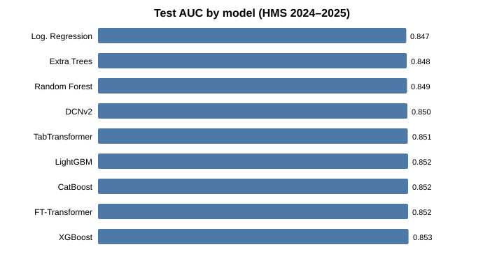
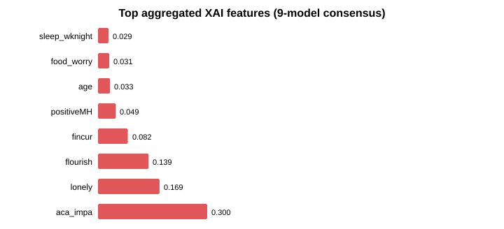
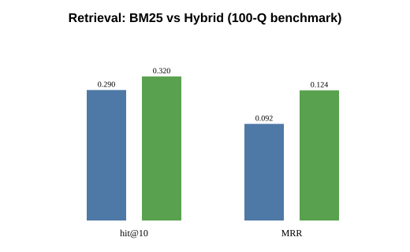
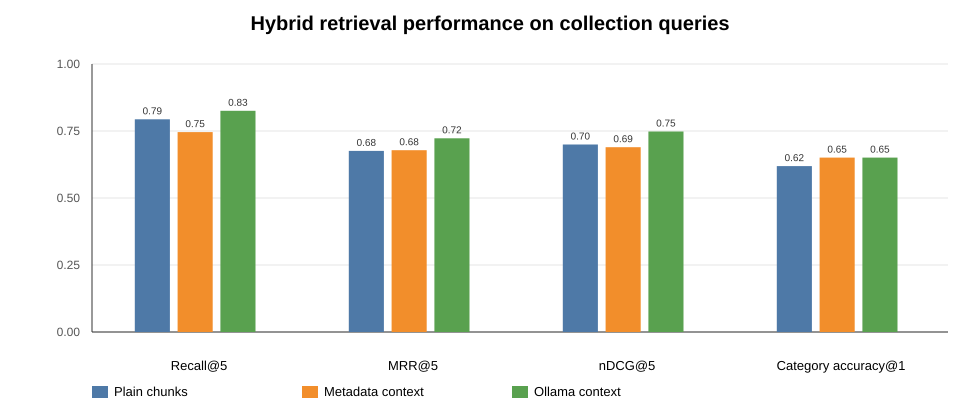
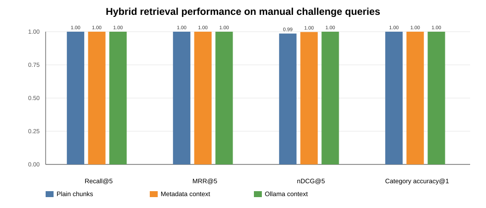

# Scientific Paper — Data Description, Methodology, Results, and Figures

**Project:** Explainability-Augmented Agentic XAI-RAG for Non-Clinical College Student Depression/Anxiety Screening Communication  
**HMS wave:** 2024–2025 | **Random seed:** 42  
**Document purpose:** Paper-ready dataset description, methods summary, result tables, and figure embeds. Adapt sections directly into Methods, Results, and Supplementary Materials.

---

## 1. Dataset

### 1.1 Source and sample

This study used the **Healthy Minds Study (HMS) 2024–2025 public release with institutional characteristics**, a large-scale survey of U.S. college and university students. The analysis file (`HMS_2024-2025_PUBLIC_instchars.csv`) contained **84,735 respondents**. After restricting the sample to completed surveys (`Finished = 1`), non-missing outcome values, and rows with at least **60% feature completeness** (≥15 of 25 predictors non-missing), the final analytic sample comprised **63,581 students**, of whom **44.9%** screened positive for elevated depression and/or anxiety.

The binary outcome **`dep_or_anx`** indicated elevated depression/anxiety screening status (1 = elevated; 0 = not elevated). Predictors (**n = 25**) spanned demographics, financial stress, sleep and exercise, social belonging and loneliness, academic impairment, positive mental health, substance use, discrimination experiences, and institutional characteristics. Gender non-binary and transgender indicators were excluded for cross-model consistency. Missing values were imputed with training-set medians; features were standardized (fit on training only). Models used HMS non-response weights (`nrweight`) where applicable. Data were split **80/10/10** (train/validation/test: **50,864 / 6,358 / 6,359**) with stratification on `dep_or_anx` (`random_state = 42`). All student records were **de-identified**; no personally identifiable information was used in generation experiments.

### 1.2 Predictor groups

| Group | Features |
| --- | --- |
| Demographics | `age`, `gender_male`, `gender_female`, `international` |
| Financial stress | `fincur`, `finpast`, `food_worry` |
| Sleep and lifestyle | `sleep_wknight`, `sleep_wkend`, `exerc` |
| Social support | `belong1`, `belong2`, `lonely` |
| Academic impact | `aca_impa` |
| Positive mental health | `flourish`, `positiveMH` |
| Substance use | `sub_any`, `binge1pl`, `smok_cig` |
| Discrimination | `discrim_race`, `discrim_gender`, `discrim_sexual` |
| Institution | `inst_type`, `inst_size`, `inst_public` |

### 1.3 Key variable definitions

| Variable | Description |
| --- | --- |
| `dep_or_anx` | Binary elevated depression/anxiety screening flag (target) |
| `aca_impa` | Academic impairment due to emotional/mental health |
| `lonely` | Self-reported loneliness |
| `flourish` | Flourishing / positive psychological functioning |
| `fincur` | Current financial stress (higher = more strain) |
| `food_worry` | Food insecurity worry |

---

## 2. System architecture (operational pipeline)

The deployed **controlled agentic XAI-RAG** system generates expert-facing, non-diagnostic screening support reports:

```
HMS row → CatBoost + TreeSHAP → Case formatter
       → Query Planning Agent (Ollama LLM)
       → Hybrid retrieval (BM25 + FAISS / nomic-embed-text)
       → Report Generation Agent (Ollama LLM)
       → JSON advisory report + citations
```

**Runtime policy:** all Ollama calls are sequential (`stream: false`), with ~1 s delay between API requests. The system does **not** diagnose or prescribe treatment; XAI outputs describe **statistical contributors** to the model score, not causal mechanisms.

**Operational predictor:** CatBoost with TreeSHAP (Phase-1 artifact). Although XGBoost achieved marginally higher test AUC (0.853 vs 0.852), performance differences were negligible; CatBoost was retained for pipeline integration with case profiles and local explanation workflows.

---

## 3. Knowledge base

### 3.1 Corpus construction

A curated scientific knowledge base (`knowledge_db/`) was assembled via: (i) structured multi-query web search (~50 queries, nine expertise categories A–I), (ii) candidate de-duplication, (iii) transparent quality scoring (six-criterion rubric, accept ≥7), (iv) legal PDF acquisition, and (v) SHA-1 deduplication with per-category trimming.

### 3.2 Production corpus statistics

| Statistic | Value |
| --- | --- |
| Documents (PDFs) | 44 |
| Chunks (production index) | 5,740 |
| Mean chunks per document | 130.5 |
| Mean chunk length (chars) | 854 |

### 3.3 Evaluation corpus (contextual retrieval study)

For the contextual-embedding ablation, a page-aware subset was used: **338 chunks** from 44 PDFs (first 8 pages per document, up to 8 chunks/doc, 260 words/chunk, 60-word overlap).

| Category | Chunks |
| --- | --- |
| A_student_mental_health | 40 |
| B_college_depression_anxiety | 42 |
| C_loneliness_isolation | 24 |
| D_academic_impairment | 32 |
| E_financial_food | 24 |
| F_sleep_wellbeing | 40 |
| G_screening_communication | 32 |
| H_xai_calibration | 56 |
| I_rag_llm_eval | 48 |

---

## 4. Predictive modeling and explainable AI

### 4.1 Model comparison (test set, n = 6,359)

Nine models were trained: six ML (logistic regression, random forest, extra trees, XGBoost, LightGBM, CatBoost) and three deep tabular models (FT-Transformer, TabTransformer, DCNv2). Discriminative performance was strong and similar across families (AUC ≈ 0.847–0.853).

| Model | Family | AUC | Accuracy | F1 | Brier |
| --- | --- | --- | --- | --- | --- |
| XGBoost | ML | **0.853** | 0.773 | 0.753 | 0.156 |
| LightGBM | ML | 0.852 | 0.770 | 0.750 | 0.157 |
| CatBoost | ML | 0.852 | 0.772 | 0.752 | 0.157 |
| FT-Transformer | DL | 0.852 | 0.768 | 0.753 | 0.158 |
| TabTransformer | DL | 0.851 | 0.769 | 0.725 | 0.157 |
| DCNv2 | DL | 0.850 | 0.771 | 0.745 | 0.157 |
| Random Forest | ML | 0.849 | 0.769 | 0.747 | 0.158 |
| Extra Trees | ML | 0.848 | 0.768 | 0.747 | 0.158 |
| Logistic Regression | ML | 0.847 | 0.766 | 0.745 | 0.160 |



### 4.2 Cross-model XAI consensus (aggregated importance)

Top features by weighted nine-model aggregation (stability × calibration × macro-F1 weighting):

| Rank | Feature | Aggregated importance | Cross-model agreement |
| --- | --- | --- | --- |
| 1 | `aca_impa` | 0.300 | High (9/9 top-10) |
| 2 | `lonely` | 0.169 | High |
| 3 | `flourish` | 0.139 | High |
| 4 | `fincur` | 0.082 | High |
| 5 | `positiveMH` | 0.049 | High |
| 6 | `age` | 0.033 | High |
| 7 | `food_worry` | 0.031 | High |
| 8 | `sleep_wknight` | 0.029 | High |



**Interpretation:** Academic impairment, loneliness, flourishing, and financial stress were the most consistent drivers across model families. `aca_impa` is partially tautological with the screening target and should be interpreted as a correlate/marker, not an independent upstream cause.

### 4.3 Explanation stability (selected models)

| Model | Stability score | Calibration (1 − Brier) |
| --- | --- | --- |
| Random Forest | 0.972 | 0.842 |
| XGBoost | 0.969 | 0.844 |
| LightGBM | 0.968 | 0.843 |
| CatBoost | 0.965 | 0.843 |

---

## 5. Retrieval evaluation

### 5.1 Controlled benchmark (100 questions, production corpus)

Embedding: `nomic-embed-text` (Ollama). Hybrid = BM25 + FAISS dense with RRF fusion.

| Retriever | P@5 | R@5 | R@10 | Hit@5 | Hit@10 | MRR | nDCG@10 |
| --- | --- | --- | --- | --- | --- | --- | --- |
| BM25 | 0.032 | 0.0045 | 0.0097 | 0.14 | 0.29 | 0.092 | 0.037 |
| Hybrid FAISS | 0.060 | 0.0077 | 0.015 | 0.23 | 0.32 | 0.124 | 0.057 |



Hybrid retrieval outperformed BM25-only on all reported metrics (e.g., Hit@10: 0.32 vs 0.29).

### 5.2 Contextual retrieval ablation (knowledge_db, K = 5)

Compared chunk representations: **plain**, **metadata-context**, **Ollama-generated context** (`qwen2.5`).  
Embedding: `nomic-embed-text`. Hybrid = 70% dense + 30% BM25.

**Main result (collection queries, n = 63):** best configuration = **Ollama context + hybrid**:

| Condition | Mode | Recall@5 | MRR@5 | nDCG@5 | Cat. Acc@1 |
| --- | --- | --- | --- | --- | --- |
| Plain | Hybrid | 0.794 | 0.676 | 0.700 | 0.619 |
| Metadata context | Hybrid | 0.746 | 0.678 | 0.690 | 0.651 |
| **Ollama context** | **Hybrid** | **0.825** | **0.723** | **0.748** | **0.651** |






**Finding:** contextualization combined with lexical retrieval yielded the largest gains, especially for acronym- and terminology-heavy queries (PHQ-9, GAD-7, SHAP, calibration).

---

## 6. Query Planning Agent evaluation

Fifty HMS test profiles (20 elevated / 20 low / 10 borderline) × five local LLM generators; judged by `gpt-oss:20b` (excluded from generators). Total: **250 plans**, **1,575 questions** (mean 6.30 per plan).

### 6.1 Level-1 automatic metrics (%)

| Model | Schema validity | Mean Qs | In 5–9 band | XAI coverage | Type coverage | Unsafe wording | Parse success |
| --- | --- | --- | --- | --- | --- | --- | --- |
| gemma4 | 98 | 6.06 | 98 | 58.3 | 78.8 | 5.4 | 100 |
| llama3 | 100 | 4.68 | 60 | 31.5 | 88.5 | 0.4 | 100 |
| mistral | 98 | 7.88 | 92 | 83.6 | 98.0 | 0.0 | 100 |
| phi4 | 100 | 6.44 | 100 | 60.1 | 100.0 | 0.0 | 100 |
| qwen2.5 | 100 | 6.44 | 100 | 46.4 | 100.0 | 0.3 | 100 |


### 6.2 Level-2 LLM judge scores (%)

| Model | Overall | Relevance | XAI align. | KDB answer. | Report useful. | Safety |
| --- | --- | --- | --- | --- | --- | --- |
| **gemma4** | **99.1** | 99.6 | 94.0 | 100.0 | 100.0 | 99.6 |
| mistral | 96.7 | 95.6 | 92.8 | 99.2 | 99.2 | 100.0 |
| phi4 | 96.6 | 96.4 | 86.0 | 100.0 | 98.8 | 98.8 |
| qwen2.5 | 95.2 | 96.8 | 74.0 | 99.6 | 98.4 | 99.6 |
| llama3 | 85.8 | 88.0 | 57.6 | 78.8 | 91.6 | 90.4 |


---

## 7. End-to-end RAG ablation (Phase 1, three preset cases)

Four systems compared with Ollama Llama 3 generation and GPT-4o-mini judging:

| System | Local XAI | Aggregated XAI | Literature RAG |
| --- | --- | --- | --- |
| S0 baseline | ✗ | ✗ | ✗ |
| S1 rag_xai | ✓ (CatBoost SHAP) | ✗ | ✓ |
| S2 rag_agg_xai | ✗ | ✓ | ✓ |
| S3 full | ✓ | ✓ | ✓ |

**System-level means (LLM-as-judge):**

| Metric | S0 baseline | S1 rag_xai | S2 rag_agg_xai | S3 full |
| --- | --- | --- | --- | --- |
| Faithfulness | 0.90 | 0.80 | 0.80 | 0.73 |
| Answer relevancy | 0.77 | **0.90** | **0.90** | **0.90** |
| Hallucination rate | 0.50 | 0.50 | **0.40** | **0.40** |
| Context recall | — | **0.70** | 0.60 | **0.70** |

XAI-augmented systems improved answer relevancy versus prediction-only baseline; aggregated XAI reduced hallucination on average.

---

## 8. Report quality and safety (controlled pipeline smoke eval)

| Metric | Value | n |
| --- | --- | --- |
| Safety pass rate | 100% | 2 preset cases |
| XAI alignment pass rate | 100% | 2 |
| Schema-valid reports | 100% | 2 |

Citation faithfulness (claim-level): 25 fully supported, 7 partially supported.

---

## 9. Master results summary

| Component | Metric | Value |
| --- | --- | --- |
| Prediction (CatBoost) | AUC | 0.852 |
| Prediction (CatBoost) | F1 | 0.752 |
| Knowledge base | Documents | 44 |
| Knowledge base | Chunks | 5,740 |
| Retrieval (hybrid) | Hit@10 | 0.32 |
| Retrieval (hybrid) | MRR | 0.124 |
| Query planning (best judge) | Overall (gemma4) | 99.1% |
| Contextual retrieval (best) | Recall@5 (Ollama hybrid) | 0.825 |

---

## 10. Limitations (for Discussion section)

| Gap | Detail |
| --- | --- |
| Sample scope | U.S. college students (HMS); generalizability to other populations is unknown |
| Screening vs diagnosis | Model output is a screening signal, not a clinical diagnosis |
| XAI causality | SHAP contributors are statistical associations, not causal effects |
| `aca_impa` tautology | Academic impairment overlaps conceptually with the mental-health target |
| Retrieval benchmark | 100-question benchmark has category-level gold; some queries are corpus-construction queries |
| Query-plan judge | Single judge (`gpt-oss:20b`); possible judge-model bias |
| Report eval n | Full end-to-end report evaluation on only 2–3 preset cases in latest pass |
| Expert review | No completed blinded expert review scores in automated evaluation |
| Local LLM variance | Results depend on Ollama model versions and hardware |

---

## 11. Figure index (all embeddable paths)

| Figure | Path (relative to this file) |
| --- | --- |
| Model AUC comparison | `charts/model_auc_comparison.svg` |
| Aggregated XAI features | `charts/aggregated_feature_importance.svg` |
| BM25 vs hybrid retrieval | `charts/retrieval_bm25_vs_hybrid.svg` |
| Contextual hybrid (collection) | `../knowledge_db_contextual_eval/outputs/charts/collection_hybrid_metrics.svg` |
| Contextual dense (collection) | `../knowledge_db_contextual_eval/outputs/charts/collection_dense_metrics.svg` |
| Manual challenge hybrid | `../knowledge_db_contextual_eval/outputs/charts/manual_challenge_hybrid_metrics.svg` |
| Query plan Level-1 | `../query_agent_eval/outputs/charts/level1_metrics.svg` |
| Query plan judge leaderboard | `../query_agent_eval/outputs/charts/judge_overall_leaderboard.svg` |
| Query plan judge dimensions | `../query_agent_eval/outputs/charts/level2_judge_dimensions.svg` |
| Query plan by stratum | `../query_agent_eval/outputs/charts/judge_by_stratum.svg` |

---

## 12. Source data files (reproducibility)

| File | Description |
| --- | --- |
| `HMS_2024-2025_PUBLIC_instchars.csv` | Raw HMS dataset |
| `xai_rag_depression/outputs/` | Phase-1 models, XAI cards, ablation results |
| `controlled_agentic_xai_rag/paper_outputs/evaluation/` | Master evaluation tables |
| `knowledge_db_contextual_eval/outputs/` | Contextual retrieval results |
| `query_agent_eval/outputs/` | Query planning agent evaluation |
| `xai_rag_depression/PIPELINE_SCIENTIFIC_REPORT.md` | Full technical report |

---

*Generated for paper inclusion. Regenerate local charts: `python paper_outputs/generate_charts.py`. Regenerate query-plan report: `python query_agent_eval/scripts/generate_scientific_report.py`. Regenerate contextual retrieval report: `python knowledge_db_contextual_eval/scripts/generate_report.py`.*
