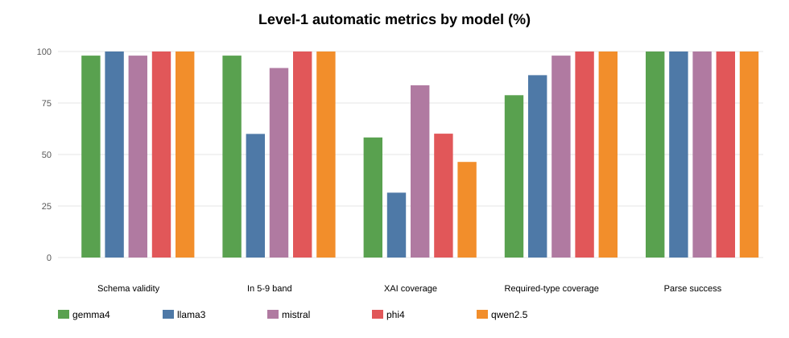
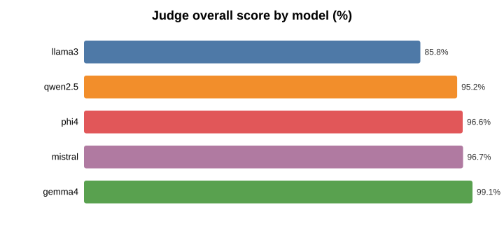
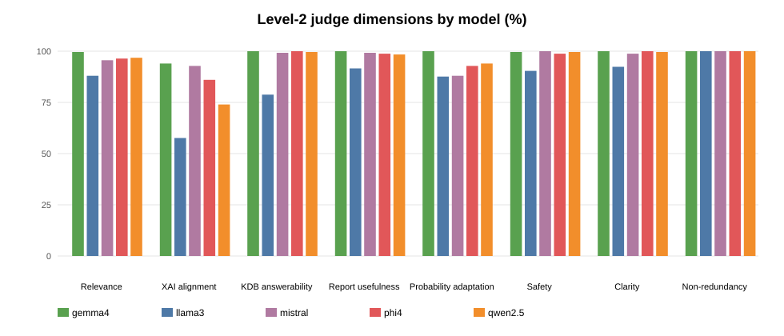
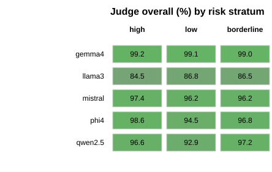

# Query Planning Agent Evaluation — Scientific Results

Paper-ready results for the autonomous **Query Planning Agent** evaluation. Five local Ollama LLMs generate evidence-seeking question plans for 50 HMS-derived student case profiles; outputs are scored with Level-1 automatic metrics and a Level-2 LLM judge (`gpt-oss:20b`).

- **Report generated:** `20260702_141606` (UTC)
- **Cases:** 50 (20 elevated / 20 low / 10 borderline)
- **Generators:** `gemma4`, `llama3`, `qwen2.5`, `phi4`, `mistral`
- **Judge:** `gpt-oss:20b` (excluded from generator set)
- **Total model-case runs:** 250 (50 x 5)
- **Total generated questions:** 1575 (mean 6.30 per plan)

## Experimental Setting

- **Task:** Autonomous query planning for non-diagnostic student depression/anxiety screening.
- **Input per case:** De-identified profile, ML probability, threshold, risk label, TreeSHAP XAI contributors, protective factors, calibration metadata.
- **Output per case:** JSON question plan (5-9 questions preferred) with retrieval queries, expected evidence, and self-check flags.
- **Execution:** Sequential generation then immediate judging; 1.0 s delay between Ollama API calls.
- **Level-1 metrics:** Schema validity, question count/band, XAI coverage, protective coverage, required question-type coverage, unsafe wording rate, redundancy rate.
- **Level-2 judge dimensions (1-5, reported as %):** relevance, XAI alignment, KDB answerability, report usefulness, probability adaptation, safety, clarity, non-redundancy.

## Level 1 — Automatic Metrics (aggregate)

| model   |   n_cases |   schema_validity |   mean_questions |   pct_in_band |   xai_coverage |   protective_coverage |   required_type_coverage |   unsafe_wording_rate |   redundancy_rate |   parse_success |
|:--------|----------:|------------------:|-----------------:|--------------:|---------------:|----------------------:|-------------------------:|----------------------:|------------------:|----------------:|
| gemma4  |        50 |                98 |             6.06 |            98 |           58.3 |                   100 |                     78.8 |                   5.4 |               0   |             100 |
| llama3  |        50 |               100 |             4.68 |            60 |           31.5 |                   100 |                     88.5 |                   0.4 |               1.7 |             100 |
| mistral |        50 |                98 |             7.88 |            92 |           83.6 |                   100 |                     98   |                   0   |               5.3 |             100 |
| phi4    |        50 |               100 |             6.44 |           100 |           60.1 |                   100 |                    100   |                   0   |               0   |             100 |
| qwen2.5 |        50 |               100 |             6.44 |           100 |           46.4 |                   100 |                    100   |                   0.3 |               0.2 |             100 |

### Interpretation (Level 1)

- **`phi4`** achieved the highest required question-type coverage (100.0%) and in-band question count (100.0%).
- **`mistral`** achieved the highest XAI factor coverage (83.6%).
- **`llama3`** generated the fewest questions on average (4.68) and only 60.0% within the preferred 5-9 band.
- Unsafe wording was rare overall (16 model-case rows with any unsafe question); `gemma4` had the highest unsafe-wording rate (5.4%).

## Level 2 — LLM Judge Scores (aggregate, %)

| model   |   judge_relevance |   judge_xai_alignment |   judge_kdb_answerability |   judge_report_usefulness |   judge_probability_adaptation |   judge_safety |   judge_clarity |   judge_non_redundancy |   judge_overall |
|:--------|------------------:|----------------------:|--------------------------:|--------------------------:|-------------------------------:|---------------:|----------------:|-----------------------:|----------------:|
| gemma4  |              99.6 |                  94   |                     100   |                     100   |                          100   |           99.6 |           100   |                    100 |            99.1 |
| llama3  |              88   |                  57.6 |                      78.8 |                      91.6 |                           87.6 |           90.4 |            92.4 |                    100 |            85.8 |
| mistral |              95.6 |                  92.8 |                      99.2 |                      99.2 |                           88   |          100   |            98.8 |                    100 |            96.7 |
| phi4    |              96.4 |                  86   |                     100   |                      98.8 |                           92.8 |           98.8 |           100   |                    100 |            96.6 |
| qwen2.5 |              96.8 |                  74   |                      99.6 |                      98.4 |                           94   |           99.6 |            99.6 |                    100 |            95.2 |

### Leaderboard (judge overall)

| model   |   overall_% |
|:--------|------------:|
| gemma4  |        99.1 |
| mistral |        96.7 |
| phi4    |        96.6 |
| qwen2.5 |        95.2 |
| llama3  |        85.8 |

## Results by Risk Stratum

### Mean judge overall (%)

| model   |   borderline |   high |   low |
|:--------|-------------:|-------:|------:|
| gemma4  |         99   |   99.2 |  99.1 |
| llama3  |         86.5 |   84.5 |  86.8 |
| mistral |         96.2 |   97.4 |  96.2 |
| phi4    |         96.8 |   98.6 |  94.5 |
| qwen2.5 |         97.2 |   96.6 |  92.9 |

### Mean number of questions

| model   |   borderline |   high |   low |
|:--------|-------------:|-------:|------:|
| gemma4  |          6.1 |   6.45 |  5.65 |
| llama3  |          5.1 |   5.15 |  4    |
| mistral |          8.2 |   7.3  |  8.3  |
| phi4    |          6.9 |   6.75 |  5.9  |
| qwen2.5 |          7.2 |   7    |  5.5  |

## Main Finding

The highest mean judge overall score was **`gemma4` at 99.1%**, followed by **`mistral` (96.7%)** and **`phi4` (96.6%)**. **`llama3`** scored lowest (85.8%), driven mainly by weaker XAI alignment and KDB answerability.

Automatic metrics and judge scores are not fully aligned: `mistral` leads on XAI coverage while `gemma4` leads on judge overall. This suggests that heuristic XAI string-matching and human-like judge assessment capture partially different quality aspects.

## Example Extremes

- **Best judged plan:** `gemma4` on `hms_high_01` (100.0%, 6 questions, stratum=high).
- **Worst judged plan:** `llama3` on `hms_high_03` (67.5%, 5 questions, stratum=high).

## Data Files

| File | Description |
| --- | --- |
| `outputs/per_case_long.csv` | One row per (model, case) with all Level-1 and Level-2 fields |
| `outputs/level1_by_model.csv` | Mean automatic metrics per generator |
| `outputs/level2_by_model.csv` | Mean judge scores (%) per generator |
| `outputs/plans/{model}/{case_id}.json` | Cached question plans |
| `outputs/judge/{model}/{case_id}.json` | Cached judge scores |

## Limitations and Caveats

- **Single judge** (`gpt-oss:20b`); judge-model bias is possible.
- **Small N** (50 cases per model); treat ranking differences as indicative, not conclusive.
- **Level-1 XAI coverage** uses heuristic feature-name overlap, not semantic equivalence.
- **No retrieval execution** in this evaluation; KDB answerability is judged, not measured by actual retrieval success.
- **Generator temperature** was 0.1; judge temperature was 0.0.
